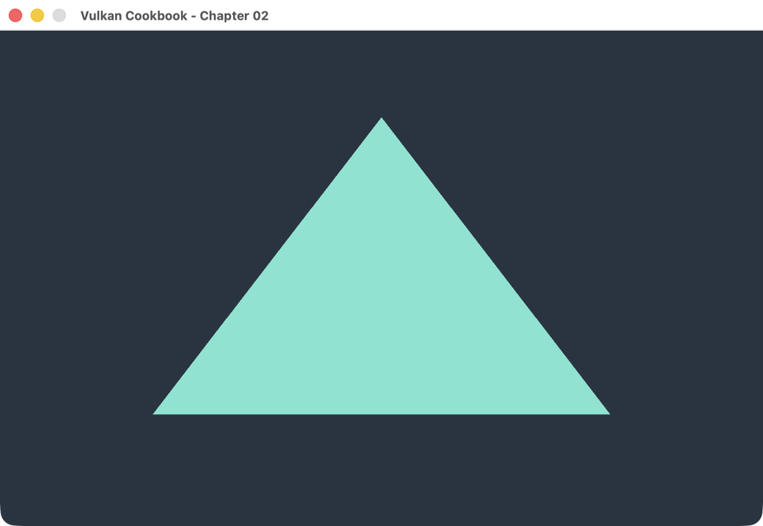

# 第 2 章 · 画出第一个三角形

[阅读图文和逐帧动画](https://gametech.byte888.com/vulkan/first-triangle.html)

这个案例用 Vulkan 1.3 的动态渲染直接向交换链图像绘制。你会看到一个深色窗口和一个薄荷绿三角形：背景由颜色附件的清除操作填上，三角形由一次 `vkCmdDraw` 画出来。



## 构建和运行

在 Apple Silicon macOS 上，用 Homebrew 安装依赖，然后从仓库根目录运行：

```sh
brew install cmake glfw glslang vulkan-headers vulkan-loader molten-vk
cmake -S . -B build
cmake --build build --parallel
./build/bin/chapter02_triangle
```

关闭窗口即可退出；也可以运行 `./build/bin/chapter02_triangle --frames 120`，完成 120 次呈现请求后自动退出。已在 Apple M5 + MoltenVK 上实测。其他平台需要支持动态渲染的 Vulkan 1.3 设备及驱动、C++20 编译器、CMake、GLFW 和 `glslangValidator`。

## 按一帧的顺序读代码

1. [顶点 Shader](shaders/triangle.vert) 根据 `gl_VertexIndex` 从三项数组取坐标；[片元 Shader](shaders/triangle.frag) 给覆盖到的片元上色。
2. 在 [main.cpp](main.cpp) 里先读 `record()`：把图像切换到颜色附件布局，清背景，画三角形，再切换到呈现布局。
3. 再读 `draw()`：取得图像索引，录制命令，提交给图形队列，最后请求呈现。示例只保留一帧在途，使用同一个队列绘制和呈现。窗口大小固定，交换链失效时退出，重新启动即可。

## 动手改

打开 `shaders/triangle.frag`，把输出改成 `vec4(1.0, 0.25, 0.05, 1.0)`。重新执行 `cmake --build build --parallel` 并启动程序：三角形会变成橙色，背景保持原样。CMake 会自动把改过的 GLSL 重新编译成 SPIR-V。
